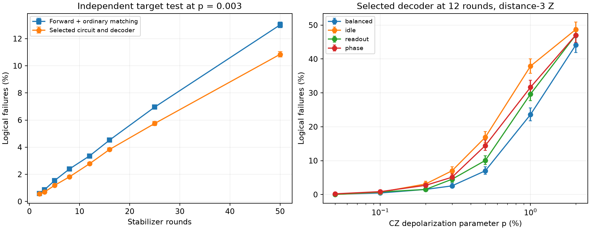

# Optimizing the no-reset memory for IQM Emerald

The submission candidate encodes one Z-basis logical qubit in a distance-3 rotated surface code on 17 physical qubits. It reverses the order of the four CZ interaction layers every second round and cancels adjacent basis rotations. Ancillas are measured each round and reused. After the experiment a decoder estimates the logical bit from the detection events. At the assumed balanced noise strength `p = 0.003`, this circuit and decoder produced 27,448 failures in 800,000 independent validation shots. A compact forward-order circuit with ordinary matching produced 33,226 failures in 800,000 shots. The comparison gives each of eight round counts equal weight.

## Run the selected experiment

Run these commands from the project directory with the virtual environment activated. The runner reads [the frozen choice](results/optimization/final_choice.json). The first command runs entirely on the laptop.

```powershell
python run_on_hardware.py --simulate --rounds 2 3 5 8 12 16 25 50 --shots 20000
```

To explore a different assumption, this example increases readout errors and compares three longer memories at the same physical noise strength.

```powershell
python run_on_hardware.py --simulate --profile readout --p 0.003 --rounds 8 16 25 --shots 20000
```

To check the circuit locally with the IQM adapter, use the first command below. The second uses the current Emerald connectivity and available error metrics from your Resonance account and only compiles. The third submits eight jobs, each with 5,000 shots. The live commands accept the `IQM_TOKEN` environment variable or prompt for a token.

```powershell
python run_on_hardware.py --iqm-fake --rounds 2 3 5 8 12 16 25 50
python run_on_hardware.py --live-compile --rounds 2 3 5 8 12 16 25 50
python run_on_hardware.py --submit --rounds 2 3 5 8 12 16 25 50 --shots 5000
```

Each invocation writes to its own directory under `results/hardware`. Submission saves a job ID for each length, measured counts, the decoder's Stim model, detector firing rates, logical failures and 95% intervals, and a fitted error rate per round. The hardware run uses the current placement and available device metrics. The noise input `--p` sets assumed missing rates. The physical noise on the chip is determined by the device.

## Physics and parameter coverage

`p` sets the simulated CZ depolarization probability. In the balanced profile a local basis rotation depolarizes with probability `p/4`, preparation and reported readout each flip with probability `p`, and each data qubit depolarizes with probability `p` during an ancilla measurement. The readout and idle profiles multiply their respective probabilities by four. The phase profile uses a Z-only idle fault with probability `4p`. These are Pauli noise assumptions. They omit leakage, coherent drift and many forms of crosstalk.

| Distance | Memory bases | Noise profiles | Values of p | Rounds | Conditions |
|---|---|---|---|---|---:|
| 3 | Z, X | Balanced, readout, idle, phase | .0005, .001, .002, .003, .005, .01, .02 | 1, 2, 3, 4, 5, 8, 12, 16, 25, 50 | 560 |
| 5 | Z, X | All four | .001, .003, .01 | 3, 8, 16, 25 | 96 |
| 7 | Z, X | Balanced | .003, .01 | 3, 8, 16 | 12 |

The screen tested three implementations per condition. The literal version expands each CX into CZ and basis rotations. The forward version cancels redundant rotations. The alternating version also reverses the sequence of four layers every other round. Every schedule used two independently seeded batches of 1,000 shots at each condition, totaling 4,008,000 shots. Three decoders read each shot. A fourth decoder subsequently read the same shots for the alternating schedule, and the replay check reproduced every previous error count. Rare-event comparisons in individual 2,000-shot cells have wide intervals. [Counts, probabilities and Wilson intervals](results/optimization/screen_intervals.csv)

Ordinary matching pairs detection events in a graph. Correlated matching also uses correlations from decomposed faults. The bounded likelihood decoder sums the probabilities of single- and double-fault explanations of a syndrome according to which logical bit they imply. The local variant applies that calculation to well-separated groups in time. It uses ordinary matching on the unresolved remainder. All four run offline and share the same measured bit record for each circuit.

## Independent test at the submission settings

We chose distance 3 to match the 17-qubit challenge patch. A balanced profile, `p = .003`, and Z memory define the target for selection. Each of the two compact schedules received 50,000 selection shots at each of eight lengths. All four decoders saw identical shots within each schedule. We locked the single schedule and decoder that minimized total selection errors, then generated new shots from different seeds. The table uses 100,000 new shots per circuit per row. [Selection scores](results/optimization/final_choice.json) · [Validation counts and joint decoder outcomes](results/optimization/four_decoder_final.csv)

| Rounds | Forward + ordinary matching, P_L | Alternating + local likelihood, P_L |
|---:|---:|---:|
| 2 | 0.598% | 0.557% |
| 3 | 0.857% | 0.693% |
| 5 | 1.530% | 1.179% |
| 8 | 2.396% | 1.818% |
| 12 | 3.356% | 2.779% |
| 16 | 4.525% | 3.833% |
| 25 | 6.954% | 5.747% |
| 50 | 13.010% | 10.842% |

Averaging evenly across lengths gives 4.153% for the reference and 3.431% for the selected method. The difference is 0.722 percentage points (approximate stratified 95% interval 0.664 to 0.780), a 17.4% relative reduction. On identical alternating-schedule shots the selected decoder also had 2,236 fewer failures than correlated matching. At two rounds the forward schedule with the local likelihood decoder achieved 0.508%, illustrating the effect of choosing a single submission configuration across lengths.

The challenge fits the curve `P_L(r) = [1 − (1 − 2ε)^r] / 2`. The selected circuit gives ε = 0.2429% per round (model-based 95% interval 0.2399% to 0.2459%). Starting the fit at round 3 gives 0.2422%. The all-round fit shows a statistically detectable departure from a constant rate (Pearson χ² = 20.79 for 7 degrees of freedom, p = .0041). Use the table for comparisons at specific lengths. [Fit, uncertainty and paired decoder comparisons](results/optimization/outcomes.json)



## When the preferred optimization changes

### Your original three-round benchmark

We ran the original distance-3 Z script's circuit builder at each of your four noise values, alongside three no-reset alternatives, using 200,000 new shots per table cell. The first two columns of results use the starter's CX-based noise model. The last two use the balanced native-CZ noise model. Comparisons within each pair hold the noise convention fixed. Sampling uncertainty explains why an independent repeat at the same settings can produce a different last digit. [All 16 measurements, seeds and 95% intervals](results/optimization/starter_comparison.csv)

| p | Starter, reset CX | No-reset CX, ordinary matching | No-reset CZ, forward + ordinary | No-reset CZ, selected |
|---:|---:|---:|---:|---:|
| .001 | 0.0740% | 0.0920% | 0.1065% | 0.0790% |
| .003 | 0.6320% | 0.6955% | 0.8950% | 0.7355% |
| .005 | 1.7485% | 1.8330% | 2.3225% | 1.8615% |
| .010 | 5.8270% | 6.2280% | 7.5045% | 6.7445% |

At all four values the selected circuit improved on the native-CZ reference. The original reset circuit gave lower point estimates. Emerald requires reuse of measured ancillas, and compiling into CZ gates changes which operations receive errors.

### Distance, noise and decoder choice

- Across all 668 conditions with equal weight on the alternating schedule, correlated matching had 144,113 failures, local likelihood had 148,233, bounded likelihood had 149,344, and ordinary matching had 150,837 in 1,336,000 shots each. The distance-3 Z selection answers a different question from this heterogeneous average. The runner accepts `--decoder correlated` to evaluate that alternative.
- At distance 3, Z basis, 12 rounds, and `p = .003`, the selected decoder failed in 51/2,000 shots with balanced noise, 90/2,000 with elevated readout noise, 140/2,000 with elevated idle depolarization and 102/2,000 with elevated phase noise. Holding the balanced rates fixed relative to each other and increasing `p` to .01 raised failures to 472/2,000. The hardware error mix can change the apparent gain.
- At eight Z rounds with balanced `p = .003`, distance 3, 5 and 7 gave 36, 13 and 3 failures respectively out of 2,000 per distance. At `.01` the corresponding counts were 349, 346 and 338. These cells illustrate distance scaling and sampling uncertainty. They do not establish an Emerald threshold.
- Using profile-matched decoder weights on the same shots reduced failures from 8,382 to 7,980 for heavy readout, from 8,707 to 8,321 for heavy phase noise, and from 9,877 to 9,857 for heavy idle noise (72,000 shots per profile). [Weights and individual conditions](results/optimization/noise_mismatch.csv)
- A separate detector-correlation experiment tested 120 settings with clean, joint-fault and independent-fault controls. A model that could fit joint faults identified the correct fault family in 115 settings. It reduced held-out failures for joint faults and slightly increased them under independent faults. [Paper-by-paper methods, limitations and results](PAPER_STUDY.md)

## Hardware feasibility

The runner searches up to 1,024 exact CZ embeddings and scores them using the frequency of each CZ and measurement and the associated error metrics. It selects one physical patch using the longest circuit and uses that placement for every length. The decoder uses available per-location rotation, CZ and readout error estimates and profile assumptions for preparation and idle errors. Its Pauli approximation treats a basis rotation as one noisy pulse. The layout score estimates accumulated error exposure, while logical failure is measured separately.

The pinned IQM adapter validated all eight circuits on IQM's local Aphrodite fixture. The search examined 92 embeddings. At 3 rounds the compiled circuit used 72 CZ gates, 94 rotations, 33 measurements and depth 27. At 50 rounds it used 1,200 CZ gates, 409 measurements and depth 450. Every circuit used 17 physical qubits with zero SWAPs and zero reset instructions. A separate noisy test used the fixture's synthetic location-dependent gate and readout errors for both memory bases and 3, 8, 16 and 25 rounds. With matching weights, choosing the scored layout reduced failures from 69,962 to 66,308 per 240,000 shots. On that selected layout the balanced prior gave 71,598 failures on the same shots. Actual Emerald performance still requires a run on the processor. [Fixture compilation](results/iqm_fixture_final/20261121T183457331594Z/layout-search.json) · [Device-shaped noise test](results/optimization/fixture_noise.csv)

## Reproduce the study

Run from the project root. The broad benchmarks take longer than the single-circuit laptop command. Replaying the study writes the named result tables in the project. The seed and shot count for each row are included in the raw files.

```powershell
python -m unittest -v verify_qec verify_optimization
python benchmark_native.py --phases selection validation screen
python confirm_decoder.py
python confirm_decoder.py --extend-grid
python confirm_decoder.py --starter-comparison
python summarize_optimization.py
python stress_correlations.py
python benchmark_layout.py
```

The tests check noiseless detectors and graphlike distance across bases, schedules and distances, response to a correctable fault and an undetectable logical string, native IQM measurement ordering after serialization, and a decoder comparison with explicit fault enumeration. The [paper study](PAPER_STUDY.md) explains how the three supplied experiments and the online decoder literature informed these tests.
